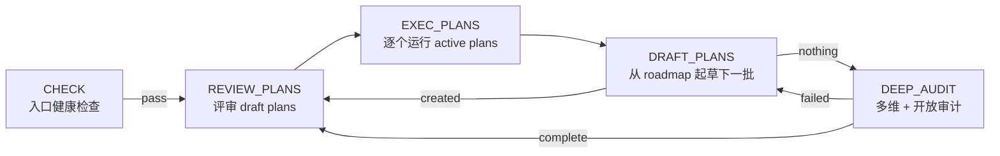
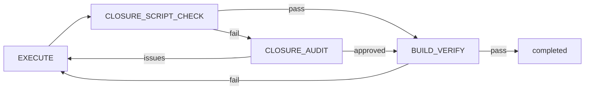
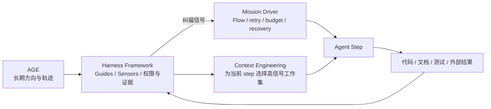

# Mission Driver / AGE / Context Engineering 沟通知识库

> 状态：**调研快照 / 沟通材料**
>
> 用途：统一下一轮讨论的事实、术语、证据层级和风险边界。
>
> 非用途：本文**不是** Harness Framework 规范、ADR、采纳结论、接入计划或改造方案。除本文件外，本轮未修改框架。

## 0. 调研快照

| 对象 | 本次核验基线 |
| --- | --- |
| 微信公众号文章 | 《Mission Driver：Loop Engineering 的一种通用参考实现》，可逆计算，发布于 2026-07-26 10:20；[原文](https://mp.weixin.qq.com/s/AFpnWdDXyp6Z9SDi_1MCqw) |
| 文章正文图片 | 正文容器内 4 张实质图片已逐张下载并按原始分辨率视觉读取；图源固定在 nop-app-erp 同一 commit，详见 §2.1 |
| Claude 5 Context Engineering 文章 | 《The new rules of context engineering for Claude 5 generation models》，Thariq Shihipar，发布 / 页面标注更新于 2026-07-24；本次核验于 2026-07-26；[原文](https://claude.com/blog/the-new-rules-of-context-engineering-for-claude-5-generation-models) |
| Claude 文章正文图片 | 正文 4 张实质 PNG 已逐张下载并按原始分辨率视觉读取；另有 1 张题图，页面中 `No items found` / 占位 SVG 属于站点模板，不作为文章证据；详见 §7.2 |
| Claude 文章直接引用的官方材料 | [Context Engineering（2025-09-29）](https://www.anthropic.com/engineering/effective-context-engineering-for-ai-agents)、[Dynamic Workflows（2026-06-02）](https://claude.com/blog/a-harness-for-every-task-dynamic-workflows-in-claude-code)、[Fable Field Guide（2026-07-06）](https://claude.com/blog/a-field-guide-to-claude-fable-finding-your-unknowns) 和 [Claude Code 文档](https://code.claude.com/docs)；均于 2026-07-26 复核 |
| AGE Template | `entropy-cloud/attractor-guided-engineering-template` `main@2cde991a98e99192d06fa4742d8b74ff9fe588f5`，提交时间 2026-07-24；[固定提交](https://github.com/entropy-cloud/attractor-guided-engineering-template/commit/2cde991a98e99192d06fa4742d8b74ff9fe588f5) |
| nop-app-erp | `main@3da6cae232bf211525d5f57f7442f75ce5742a37`，提交时间 2026-07-26；[固定提交](https://github.com/entropy-cloud/nop-app-erp/commit/3da6cae232bf211525d5f57f7442f75ce5742a37) |
| 本地 Harness Framework | `VERSION=2.1.0`，`HEAD=b3b8fd47ebc49b57abdc365f327688b33970d54c`；本地 `README.md` 有用户预存未提交修改，本轮未触碰 |

后续阅读时必须保留 commit 基线。AGE 的 flow、prompt、设计文档仍在快速演化，不应把本文描述无条件外推到未来版本。

## 1. 先说结论

一句话定位：

**AGE 主要回答“系统长期应向哪里收敛”，Harness Framework 2.1.0 回答“项目如何用 Guides、Sensors、证据和人类责任持续检测、纠偏并治理行动”，Context Engineering 回答“某一步推理此刻应该装入哪些高信号上下文”，Mission Driver 则把一类长任务的执行轨迹编排成可恢复的嵌套循环。**

四者不是同一层的替代品：

- AGE 是方向与轨迹的上位解释框架；
- Context Engineering 是每次模型推理的上下文装配与注意力预算方法；
- Mission Driver 是一套具体的自治运行时 / Flow DSL 参考实现；
- Harness Framework 2.1.0 是面向代码库的用户侧 Outer Harness 契约与控制方法。

文章还有一条不能遗漏的纵向机制：Loop 不只推进产品状态，也应改进未来 Loop 自身。人工纠正实现时，把稳定、可复用的“为什么这样改”晋级为 Skill 或编码规范；审计漏检时，改进 audit prompt。也就是同时演化**做事能力**和**检查能力**。

它们有明显重叠，也存在尚未解决的张力。尤其不能把“让模型自行判断”“新 session”“verifier agent”或“AI closure audit”直接等同于确定性安全边界或本框架要求的“来源独立 Behaviour Evidence”。

## 2. 证据分层

本文使用六种标签，讨论时不要混层：

| 标签 | 含义 | 可用于什么 |
| --- | --- | --- |
| **[作者主张]** | 公众号文章、AGE 方法论文章或说明文档表达的理念、效益或解释 | 理解作者意图，不能单独证明实现或效果 |
| **[官方建议]** | Anthropic / Claude 官方文章或产品文档给出的操作建议 | 说明官方当前推荐实践；仍需按模型、产品版本和本地风险验证 |
| **[官方自报]** | Anthropic / Claude 对内部删减、评测或产品表现的报告 | 一手案例事实，但不是公开可复现基准或第三方验证 |
| **[源码已验证]** | 当前固定 commit 的 flow、prompt、JS 源码或可执行测试直接证明 | 描述当前实现行为 |
| **[案例自报]** | 项目仓库或文章对自身周期、规模、测试和人类干预的报告 | 案例线索，不等于独立基准测试 |
| **[推论 / 待验证]** | 由多个事实推导出的风险、适用条件或开放问题 | 下一轮讨论和验证输入，不作采纳结论 |

当 README、设计文档、手册、prompt 与 flow/source 冲突时，本次运行语义核验按：

```text
flows/*.json → src/*.js → prompts/*.md → 用户手册 / 设计文档 / README
```

这只是本次“当前实现行为”的取证顺序，不改写 AGE 仓库自己的正式 source-of-truth 规则。

### 2.1 正文图片核验

本次没有把图片的 `alt`、正文转写或文件存在性当作“已经看图”。微信公众号正文容器中的 4 个实际 `data-src` 图片和固定 commit 中的 4 张对应原图均已打开，视觉内容一致；以下尺寸为仓库原图尺寸，解读来自画面本身：

| 图片 | 画面直接表达的信息 | 证据边界 |
| --- | --- | --- |
| [Loop 嵌套图（1071×450）](https://github.com/entropy-cloud/nop-app-erp/blob/3da6cae232bf211525d5f57f7442f75ce5742a37/docs/articles/images/mission-driver-loop.png) | 左侧是 `CHECK → REVIEW_PLANS → EXEC_PLANS → DRAFT_PLANS → DEEP_AUDIT` 顶层 Loop；中间把 Plan 子流画成 `EXECUTE → CLOSURE_CHECK → CLOSURE_AUDIT → BUILD_VERIFY`；右侧把审计画成“发现问题 → 生成修正 Plan → 多维度审计”的回环，以及“未发现问题 / 预算耗尽 → 顶层终止”。 | 这是作者的概念结构图，不是当前 JSON 状态机的等价展开。特别是图中 `CLOSURE_AUDIT` 是 Plan 子流必经节点，而固定 commit 的默认 flow 在结构检查 `pass` 时会绕过它，详见 §5.2。 |
| [Monitor 截图（1891×876）](https://github.com/entropy-cloud/nop-app-erp/blob/3da6cae232bf211525d5f57f7442f75ce5742a37/docs/articles/images/mission-driver-monitor.png) | 看板列出 Run ID、Mission、Flow、Status、Steps、Started、Duration，并显示 mission config 卡片。截图中的 11 个 run 为 1 `running`、1 `failed`、6 `aborted`、1 `completed`、2 `max_cycles`，可见时长从 28 分钟到 48 小时 14 分。 | 它证明监控页能呈现长运行、终止状态、步数和时长；这张静态样本不能据此计算成功率，也不能单独证明恢复正确性或长期稳定性。 |
| [知识转移曲线（1087×445）](https://github.com/entropy-cloud/nop-app-erp/blob/3da6cae232bf211525d5f57f7442f75ce5742a37/docs/articles/images/knowledge-transfer.png) | 06-22 到 07-13 间，红色“A 类频次”下降、蓝色“AI 自主度”上升，约在 06-29 至 07-01 交叉；图上标注“grill 83 问仅 4 题需纠正”“最后 A 类 + 两次关键 B 类”“几乎全 C 类，用户只提要求”。 | 这是案例叙事图。图中没有给出逐日原始数据、AI 自主度计算公式、采样规则或不确定性，因此可支撑作者如何解释知识转移，不能独立证明“吸引子定型导致人类介入归零”的因果关系。 |
| [Plan 生命周期图（1077×177）](https://github.com/entropy-cloud/nop-app-erp/blob/3da6cae232bf211525d5f57f7442f75ce5742a37/docs/articles/images/plan-loop.png) | `draft → 独立草案审查 → active → 执行 Phase（含验证）→ 独立结束审计 → completed`；`needs_revision` 回到 draft，结束审计 `fail` 回到 active。 | 图示的设计意图是生成与验收分离，且由独立结束审计把 plan 推到 `completed`。当前 execute prompt 和默认 flow 没有完全落实这一生命周期，详见 §5.2 与 R2。 |

因此，四张图的性质并不相同：Loop 图和 Plan 图主要表达**设计意图**，Monitor 是**实现界面截图**，知识转移曲线是**案例自报的解释性可视化**。后续沟通不能把三种证据互相替代。

## 3. 术语表

| 术语 | 本文采用的工作定义 |
| --- | --- |
| **Loop Engineering** | [作者主张] 用循环、反馈、重试和局部容错替代一次性线性提示 / pipeline 的工程思路；文章把 Mission Driver 称为一种通用参考实现。[来源](https://mp.weixin.qq.com/s/AFpnWdDXyp6Z9SDi_1MCqw) |
| **AGE** | Attractor-Guided Engineering，吸引子引导工程；关注仓库在持续人机变更中应向什么结构收敛。[来源](https://github.com/entropy-cloud/attractor-guided-engineering-template/blob/2cde991a98e99192d06fa4742d8b74ff9fe588f5/README.zh.md#L13-L31) |
| **State Space / 状态空间** | 仓库在当前约束下可能演化出的代码、文档、测试等状态集合。[来源](https://github.com/entropy-cloud/attractor-guided-engineering-template/blob/2cde991a98e99192d06fa4742d8b74ff9fe588f5/docs/articles/attractor-before-harness-ai-large-scale-development-methodology.md#L61-L80) |
| **Attractor / 吸引子** | 系统在长期扰动中反复被拉回的稳定结构，不是单一终点、边界或检查清单。[来源](https://github.com/entropy-cloud/attractor-guided-engineering-template/blob/2cde991a98e99192d06fa4742d8b74ff9fe588f5/docs/articles/attractor-before-harness-ai-large-scale-development-methodology.md#L84-L104) |
| **Trajectory / 轨迹** | 人、AI、review、CI 和文档更新共同留下的真实演化路径。[来源](https://github.com/entropy-cloud/attractor-guided-engineering-template/blob/2cde991a98e99192d06fa4742d8b74ff9fe588f5/docs/articles/attractor-before-harness-ai-large-scale-development-methodology.md#L65-L80) |
| **Control / 控制** | 通过局部信号持续影响、测量和纠正轨迹的机制；harness 属于控制层。[来源](https://github.com/entropy-cloud/attractor-guided-engineering-template/blob/2cde991a98e99192d06fa4742d8b74ff9fe588f5/docs/articles/attractor-before-harness-ai-large-scale-development-methodology.md#L169-L216) |
| **Owner Doc** | 对“应构建什么 / 应向何处收敛”有稳定所有权的文档；AGE 模板把需求、设计、架构等问题分配给不同事实源。[来源](https://github.com/entropy-cloud/attractor-guided-engineering-template/blob/2cde991a98e99192d06fa4742d8b74ff9fe588f5/docs/context/source-of-truth-and-precedence.md) |
| **Roadmap** | 里程碑索引、工作项状态面和下一工作选择入口；不是实现规格、设计文档或 plan。[来源](https://github.com/entropy-cloud/attractor-guided-engineering-template/blob/2cde991a98e99192d06fa4742d8b74ff9fe588f5/docs/backlog/00-roadmap-authoring-guide.md#L12-L68) |
| **Plan** | 一次非平凡执行切片的范围、证据和关闭合同，不是长期 owner doc，也不只是 todo list。[来源](https://github.com/entropy-cloud/attractor-guided-engineering-template/blob/2cde991a98e99192d06fa4742d8b74ff9fe588f5/docs/plans/00-plan-authoring-and-execution-guide.md#L28-L43) |
| **Mission** | 一次任务运行定义，配置 flow、roadmap、plansDir、commands、模型和 prompt 等。[来源](https://github.com/entropy-cloud/attractor-guided-engineering-template/blob/2cde991a98e99192d06fa4742d8b74ff9fe588f5/tools/mission-driver/docs/user-manual.zh.md#L263-L277) |
| **Flow / Step / Marker** | Flow 是 JSON 状态机；Step 是 agent/tool/script/group/subflow 节点；Marker 是 agent 输出的结果标签，用来选择 transition。[来源](https://github.com/entropy-cloud/attractor-guided-engineering-template/blob/2cde991a98e99192d06fa4742d8b74ff9fe588f5/tools/mission-driver/docs/user-manual.zh.md#L263-L277) |
| **Plan Loop** | 本文特指单个 active plan 的 `plan-execution` 子流，而不是整个 mission 主循环。 |
| **Deep Audit** | mission 无新 roadmap plan 可起草时进入的多维审计 / 开放审计 / remediation plan 循环。[来源](https://github.com/entropy-cloud/attractor-guided-engineering-template/blob/2cde991a98e99192d06fa4742d8b74ff9fe588f5/tools/mission-driver/flows/deep-audit-loop.json) |
| **Fresh Session** | 当前实现中，正常 agent step 默认不复用上一步 session；它意味着上下文隔离，不自动意味着不同审查主体或独立证据。 |
| **Behaviour Evidence** | Harness Framework 2.1.0 中独立于当前实现生成过程的关键行为验收依据，例如人工批准 fixture、既有 contract test、外部验收样例、生产回放或关键路径人工测试。[本地定义](./HARNESS-ENGINEERING.md#behaviour-harness) |
| **Context Engineering** | [官方定义] 在每次 LLM inference 时策划和维护包括 system prompt、tools、外部数据、history 等在内的 token 集合，使有限注意力预算中的高信号信息最大化。[来源，发布于 2025-09-29；核验于 2026-07-26](https://www.anthropic.com/engineering/effective-context-engineering-for-ai-agents) |
| **Progressive Disclosure** | 不把所有材料预先塞入 context，而是保留路径、链接、工具定义等索引，让 agent 在需要时逐层加载；它依赖可靠路由和检索，不保证必然找到关键材料。 |
| **Context Rot / Pollution** | 上下文变长、无关或冲突信息增多后，检索精度、长距离推理或目标保持出现渐进退化；不是“达到某个 token 数就突然失效”的硬阈值。[来源，2025-09-29](https://www.anthropic.com/engineering/effective-context-engineering-for-ai-agents) |
| **Compaction** | 将接近上限的会话摘要后在新 context 中继续；能延长任务，但摘要是有损选择，可能遗失后来才显出重要性的约束。[来源，2025-09-29](https://www.anthropic.com/engineering/effective-context-engineering-for-ai-agents) |
| **Auto-memory** | Claude Code 自动保存并跨 session 召回工作相关经验的产品能力。官方文档核验于 2026-07-26：它按 repository 隔离、同一 repo 的 worktrees 共享、只保存在当前 machine；每次会话常驻加载 `MEMORY.md` 前 200 行或 25KB，topic files 按需读取。它是 context，不是 enforcement。[官方文档](https://code.claude.com/docs/en/memory) |

## 4. AGE：四对象和边界

### 4.1 四对象

AGE 的核心逻辑顺序是：

```text
State Space → Attractor → Trajectory → Control
```

**[作者主张]** 这不是普通流程顺序，而是逻辑依赖：没有状态空间就无从定义吸引子；没有吸引子就无法判断轨迹是否漂移；没有轨迹判断，控制就没有统一方向。[来源](https://github.com/entropy-cloud/attractor-guided-engineering-template/blob/2cde991a98e99192d06fa4742d8b74ff9fe588f5/docs/articles/attractor-before-harness-ai-large-scale-development-methodology.md#L61-L82)

### 4.2 Attractor / doc / code / roadmap / plan / harness

| 对象 | 边界 |
| --- | --- |
| **Attractor** | 少量长期结构不变量，回答“系统应持续回到什么结构”。它不是所有合法状态的枚举，也不是红线集合。[来源](https://github.com/entropy-cloud/attractor-guided-engineering-template/blob/2cde991a98e99192d06fa4742d8b74ff9fe588f5/docs/articles/attractor-before-harness-ai-large-scale-development-methodology.md#L84-L102) |
| **Docs** | 吸引子的可版本化、可审计载体；文档不是吸引子本体。对长期收敛方向，稳定 owner docs 有权威；文档若过时则必须先分类 doc drift / implementation drift。[来源](https://github.com/entropy-cloud/attractor-guided-engineering-template/blob/2cde991a98e99192d06fa4742d8b74ff9fe588f5/docs/context/source-of-truth-and-precedence.md#L134-L151) |
| **Code** | 当前实现行为和吸引子“此刻投影”的证据；代码能回答“现在怎样运行”，不能单独回答“长期应该怎样”。[来源](https://github.com/entropy-cloud/attractor-guided-engineering-template/blob/2cde991a98e99192d06fa4742d8b74ff9fe588f5/docs/articles/attractor-before-harness-ai-large-scale-development-methodology.md#L96-L104) |
| **Roadmap** | 人类可读的宏观 steering / observation surface，也是 AI work queue；只管理 milestone/work-item 状态和顺序，不承载实现步骤或详细业务规则。[来源](https://github.com/entropy-cloud/attractor-guided-engineering-template/blob/2cde991a98e99192d06fa4742d8b74ff9fe588f5/docs/backlog/00-roadmap-authoring-guide.md#L29-L53) |
| **Plan** | 一轮局部扩张如何有效关闭的合同：baseline、goals/non-goals、exit criteria、proof、closure。它属于控制和轨迹记录，不是稳定系统定义。[来源](https://github.com/entropy-cloud/attractor-guided-engineering-template/blob/2cde991a98e99192d06fa4742d8b74ff9fe588f5/docs/articles/attractor-before-harness-ai-large-scale-development-methodology.md#L183-L201) |
| **Harness** | routing、plan/closure、verification、audit、memory 等局部测量与纠偏基础设施；它回答“如何持续拉回轨迹”，不是“方向本身”。[来源](https://github.com/entropy-cloud/attractor-guided-engineering-template/blob/2cde991a98e99192d06fa4742d8b74ff9fe588f5/docs/articles/attractor-before-harness-ai-large-scale-development-methodology.md#L169-L216) |

需保留一个术语张力：

- **[作者主张]** 公众号文章明确说 roadmap 是吸引子的任务化投影，不是吸引子本身。[来源](https://mp.weixin.qq.com/s/AFpnWdDXyp6Z9SDi_1MCqw)
- **[仓库说明]** AGE Template README 又把 `docs/backlog/` 列入“吸引子的持久 owner 文件”集合。[来源](https://github.com/entropy-cloud/attractor-guided-engineering-template/blob/2cde991a98e99192d06fa4742d8b74ff9fe588f5/README.zh.md#L21-L31)
- **[推论 / 待验证]** 沟通时可暂用较窄口径：稳定 attractor 主要由已确认的产品 / 设计 / 架构不变量承载；requirements 是实现解释，roadmap/backlog 是任务化与调度面。是否采用这套窄口径，需要下一轮明确。

## 5. Mission Driver 的当前运行机制

### 5.1 主循环

当前 `main@2cde991` 默认 flow 是：



**[源码已验证]**

- `CHECK` 是入口，不在正常循环回边上；失败直接终止 mission。[主 flow](https://github.com/entropy-cloud/attractor-guided-engineering-template/blob/2cde991a98e99192d06fa4742d8b74ff9fe588f5/tools/mission-driver/flows/mission-driver.json#L32-L48)
- `EXEC_PLANS` 对 `activePlans()` 启动 `plan-execution` 子流；某些 / 全部子流失败仍转到 `DRAFT_PLANS`，因此 plan 级失败可局部化。[主 flow](https://github.com/entropy-cloud/attractor-guided-engineering-template/blob/2cde991a98e99192d06fa4742d8b74ff9fe588f5/tools/mission-driver/flows/mission-driver.json#L49-L67)
- `DRAFT_PLANS.created` 回 review，`nothing` 进 deep audit；deep audit 后继续循环。[主 flow](https://github.com/entropy-cloud/attractor-guided-engineering-template/blob/2cde991a98e99192d06fa4742d8b74ff9fe588f5/tools/mission-driver/flows/mission-driver.json#L68-L102)
- 引擎支持 `agent`、`tool`、`script`、`group`、`subflow` 五种 step；局部容错取决于每个 flow 的 transition / retry / onError 配置，不是引擎对所有失败的统一保证。[引擎分派](https://github.com/entropy-cloud/attractor-guided-engineering-template/blob/2cde991a98e99192d06fa4742d8b74ff9fe588f5/tools/mission-driver/src/engine.js#L1627-L1643)
- 项目可以覆盖 flow 和 prompts，但自定义 `scriptId` 必须在引擎侧注册，不能只靠项目 `missions/` 注入；因此“完全通过配置、不改引擎”的说法存在边界。[用户手册](https://github.com/entropy-cloud/attractor-guided-engineering-template/blob/2cde991a98e99192d06fa4742d8b74ff9fe588f5/tools/mission-driver/docs/user-manual.zh.md#L250-L259)

### 5.2 当前 Plan Loop

当前默认 `plan-execution.json` 的真实分支是：



**[源码已验证]** 结构检查通过时直接进入 `BUILD_VERIFY`；只有结构检查失败才进入 `CLOSURE_AUDIT`。[当前 plan flow](https://github.com/entropy-cloud/attractor-guided-engineering-template/blob/2cde991a98e99192d06fa4742d8b74ff9fe588f5/tools/mission-driver/flows/plan-execution.json#L16-L67)

这与三份说明存在明确张力：

1. Plan 指南规定 created plan 必须由独立 closure audit 接受后才可 `completed`。[Plan 指南](https://github.com/entropy-cloud/attractor-guided-engineering-template/blob/2cde991a98e99192d06fa4742d8b74ff9fe588f5/docs/plans/00-plan-authoring-and-execution-guide.md#L42-L61)
2. closure-audit prompt 包含 `SCRIPT_CHECK_RESULT is PASS` 的语义验证分支。[prompt](https://github.com/entropy-cloud/attractor-guided-engineering-template/blob/2cde991a98e99192d06fa4742d8b74ff9fe588f5/tools/mission-driver/prompts/closure-audit.md#L42-L69)
3. 用户手册把子流简写为 `EXECUTE → CLOSURE_SCRIPT_CHECK → CLOSURE_AUDIT → BUILD_VERIFY`，暗示 audit 是常规节点。[用户手册](https://github.com/entropy-cloud/attractor-guided-engineering-template/blob/2cde991a98e99192d06fa4742d8b74ff9fe588f5/tools/mission-driver/docs/user-manual.zh.md#L556-L567)

**当前结论：** 在默认 flow 下，结构检查 `pass` 时 closure-audit 的 PASS 语义分支近似不可达；因此不能把文章所称“强制独立结束审计”写成当前实现已验证事实。项目覆盖 flow 时可能改变这一行为。

### 5.3 Fresh Session

**[源码已验证]**

- 正常 agent step 每次以 `sessionId=null` 调用，跨 step 默认新会话。[引擎分派](https://github.com/entropy-cloud/attractor-guided-engineering-template/blob/2cde991a98e99192d06fa4742d8b74ff9fe588f5/tools/mission-driver/src/engine.js#L1627-L1641)
- runner 只有收到 sessionId 时才拼入 `--session`；否则删除该参数。[runner](https://github.com/entropy-cloud/attractor-guided-engineering-template/blob/2cde991a98e99192d06fa4742d8b74ff9fe588f5/tools/mission-driver/src/runner.js#L24-L49)
- 无 marker 的 parse fallback 是新会话；已有但非法 marker 的 correction path 才复用最近 session。[引擎解析路径](https://github.com/entropy-cloud/attractor-guided-engineering-template/blob/2cde991a98e99192d06fa4742d8b74ff9fe588f5/tools/mission-driver/src/engine.js#L803-L879)

**[推论 / 待验证]** Fresh session 只证明上下文重置；默认仍由同一 driver/model、同一仓库材料、相近 prompt 体系完成生成与判断。它不等于：

- 不同审查主体；
- 独立权限域；
- 与实现生成过程来源独立的测试 / fixture；
- 人类对业务意图、风险和责任的验收。

### 5.4 中断、恢复与持久化

**[源码已验证 / 仓库说明]**

- `EXECUTE` prompt 让 agent 逐 phase 更新 `[x]/[ ]` 和 `Status`，下次执行只处理未完成 phase。[execute prompt](https://github.com/entropy-cloud/attractor-guided-engineering-template/blob/2cde991a98e99192d06fa4742d8b74ff9fe588f5/tools/mission-driver/prompts/execute.md#L1-L15)
- 每次运行有独立 `_tmp/<runId>/run-state.json`、事件和日志用于观测与复盘。[用户手册](https://github.com/entropy-cloud/attractor-guided-engineering-template/blob/2cde991a98e99192d06fa4742d8b74ff9fe588f5/tools/mission-driver/docs/user-manual.zh.md#L263-L277)
- Mission Driver **不支持 checkpoint 原地续跑**；`--from-step` 会开启新 run。跨 run 恢复主要依赖 plan / roadmap / audit 文件状态，`completed` plan 不再进入执行队列。[用户手册](https://github.com/entropy-cloud/attractor-guided-engineering-template/blob/2cde991a98e99192d06fa4742d8b74ff9fe588f5/tools/mission-driver/docs/user-manual.zh.md#L716-L726)
- 新 run 会把已无存活进程的旧 `running` run-state 标为 `aborted`；这是状态修复，不是恢复原执行栈。[reconcile 源码](https://github.com/entropy-cloud/attractor-guided-engineering-template/blob/2cde991a98e99192d06fa4742d8b74ff9fe588f5/tools/mission-driver/src/run-reconcile.mjs#L112-L180)

因此“磁盘恢复”应准确理解为：**从持久化的仓库控制面重新计算下一步**，而不是事务日志回放或精确恢复到被中断的进程指令。

## 6. 作者主张、源码事实、案例自报和推论

### 6.1 作者主张

- Mission Driver 通过主循环、Plan Loop、可选 Audit Loop 的嵌套获得局部容错与长时间自治能力。[文章](https://mp.weixin.qq.com/s/AFpnWdDXyp6Z9SDi_1MCqw)
- Human On The Loop 可把人的位置从实时执行节点移到异步控制因子，并让模型选择从低延迟优先转向单位成本累积产出优先。[文章](https://mp.weixin.qq.com/s/AFpnWdDXyp6Z9SDi_1MCqw)
- AGE 中吸引子在逻辑上先于 harness；人类负责提出新的吸引子，AI 围绕已定义吸引子扩张，harness 负责持续拉回轨迹。[AGE 方法论](https://github.com/entropy-cloud/attractor-guided-engineering-template/blob/2cde991a98e99192d06fa4742d8b74ff9fe588f5/docs/articles/attractor-before-harness-ai-large-scale-development-methodology.md#L218-L240)
- AGE 实践把反馈分成两条改进轨道：实现或 plan 被人工纠正后，由独立子 agent 对比前后版本，提取通用规则写入 Skill / 编码规范；审计遗漏问题后，把新检查维度补入 audit prompt。[固定文章源码](https://github.com/entropy-cloud/nop-app-erp/blob/3da6cae232bf211525d5f57f7442f75ce5742a37/docs/articles/mission-driver--loop-engineering.md#L297-L316)
- 文章把 Codex goal 定位为“单 thread 持续目标”机制，把 Mission Driver 定位为“多 plan、可异步注入、子流隔离、外部强制终止”的工程运行时，并以状态持久化、独立验证、粒度、异步交互、失败隔离、终止和可见性七个维度比较二者。[固定文章源码](https://github.com/entropy-cloud/nop-app-erp/blob/3da6cae232bf211525d5f57f7442f75ce5742a37/docs/articles/mission-driver--loop-engineering.md#L482-L510)

这些是方法论立场，不自动证明在任意仓库、任意模型和任意风险等级下成立。

### 6.2 源码已验证

- 默认主循环、子流、重试、审计轮次和死循环上限由声明式 flow 决定。[主 flow](https://github.com/entropy-cloud/attractor-guided-engineering-template/blob/2cde991a98e99192d06fa4742d8b74ff9fe588f5/tools/mission-driver/flows/mission-driver.json)
- plan 级失败可按配置隔离；但 `CHECK` 失败会终止 mission，所以“任何单步失败都不影响整体”不是当前实现的普遍性质。[主 flow](https://github.com/entropy-cloud/attractor-guided-engineering-template/blob/2cde991a98e99192d06fa4742d8b74ff9fe588f5/tools/mission-driver/flows/mission-driver.json#L32-L102)
- 正常 step 默认新 session，但 closure audit 并非当前默认 Plan Loop 的必经节点。[Plan flow](https://github.com/entropy-cloud/attractor-guided-engineering-template/blob/2cde991a98e99192d06fa4742d8b74ff9fe588f5/tools/mission-driver/flows/plan-execution.json)
- 默认 runner 参数包含 `--dangerously-skip-permissions`。[runner](https://github.com/entropy-cloud/attractor-guided-engineering-template/blob/2cde991a98e99192d06fa4742d8b74ff9fe588f5/tools/mission-driver/src/runner.js#L9-L23)
- health check 允许 dirty working tree，只拦未解决 merge conflict。[health-check prompt](https://github.com/entropy-cloud/attractor-guided-engineering-template/blob/2cde991a98e99192d06fa4742d8b74ff9fe588f5/tools/mission-driver/prompts/health-check.md#L7-L16)
- `BUILD_VERIFY` 不只是读测试结果；prompt 还允许修复、更新日志和提交，batch 模式写有 `Commit everything`。[build-verify prompt](https://github.com/entropy-cloud/attractor-guided-engineering-template/blob/2cde991a98e99192d06fa4742d8b74ff9fe588f5/tools/mission-driver/prompts/build-verify.md#L11-L70)

### 6.3 案例自报

公众号文章报告 nop-app-erp 在 22 天内形成 154 个 Maven 模块、约 2890 个 Java tests、260+ Playwright specs、187 份 plan、28 次人类干预，并称这些指标经过独立审计校准。[文章](https://mp.weixin.qq.com/s/AFpnWdDXyp6Z9SDi_1MCqw)

当前 `nop-app-erp@3da6cae` README 则自报：

- `mvn clean install -DskipTests`：146 个 reactor 模块；
- `mvn test`：312+ tests，0 Failure / 0 Error。

[固定 commit README](https://github.com/entropy-cloud/nop-app-erp/blob/3da6cae232bf211525d5f57f7442f75ce5742a37/README.md#L54-L63)

两组数字的快照、统计对象或口径显然不同。本文不混用，也不把文章数字写成当前仓库已复现事实。

### 6.4 本次额外核验

在本机 macOS / Node `v26.4.0` 对 AGE `2cde991` 执行仓库声明的
`npm --prefix tools/mission-driver test`；其中一次稳定汇总为 `556 tests / 549 pass / 7 fail`，因此本次不能复述用户手册中的“556 pass”作为当前环境已验证事实。测试入口见 [package.json](https://github.com/entropy-cloud/attractor-guided-engineering-template/blob/2cde991a98e99192d06fa4742d8b74ff9fe588f5/tools/mission-driver/package.json)；失败集中在路径 / monitor、stdin / runner routing 和日志路径假设，本轮未诊断或修改 AGE 源码。

### 6.5 工程实践中的 Skill 生长闭环

文章描述的不是“维护一个静态 Skill 目录”，而是把工程纠正转换成未来可加载能力：

```text
AI 初稿
→ 人工修改且记录 diff / log
→ 独立子 agent 比较前后版本
→ 提取“为什么改”的稳定工作方法
→ 分类写入 Skill 或编码规范
→ 后续相关任务自动路由和加载
```

这条链路与普通 memory 不同：memory 保存一次运行的经验，Skill 保存经过提炼、可重复调用的工作方法；与 owner doc 也不同，Skill 说明“怎么做 / 怎么检查”，不能替代需求、设计和架构事实。

文章自报 nop-app-erp 的 19 个可复用 Skill 均来自这种循环改进。固定 commit 确实存在跨工具的 [`docs/skills/` 注册表](https://github.com/entropy-cloud/nop-app-erp/blob/3da6cae232bf211525d5f57f7442f75ce5742a37/docs/skills/README.md) 和 `.opencode/skills/` 工具原生 Skill；但仓库快照只能证明 Skill 资产存在，不能独立证明每个 Skill 都由纠正日志自动提取，也不能证明“19”这一口径。

对 Harness Framework 的直接启示是需要补一个明确的**经验晋级分类器**：

| 反馈内容 | 应沉淀到哪里 |
| --- | --- |
| 单次运行事实、环境偶发问题 | postmortem / memory |
| 稳定项目事实或业务决策 | owner doc / SPEC / ADR |
| 可跨任务复用的工作方法 | 项目 Skill |
| 可机械拒绝的禁区 | Redline / Deterministic Gate |
| 审计反复漏掉的维度 | Sensor / audit prompt |

当前 Harness 已有重复失败、Steering、Guide / Sensor 升级和 AI-facing Skill 维护入口，但还没有把“稳定工程方法 → 候选 Skill → 路由验证 → 评测 → Owner 批准”定义成正式闭环。

### 6.6 Codex Goal 与 Mission Driver：不是同一粒度

文章的核心对比不是“谁更强”，而是两者负责的持续性不同：

| 维度 | Codex goal 的文章定位 | Mission Driver 的文章定位 |
| --- | --- | --- |
| 工作对象 | 一个 thread 中的一个长期目标和 token budget | 一个 mission 下的多个 plan 与嵌套 flow |
| 状态 | SQLite / rollout / goal 状态 | checkbox、plan 文件、run-state 等文件控制面 |
| 反馈 | continuation 中模型继续推进和自审 | script、audit、build、postmortem 多级反馈 |
| 新工作进入 | 继续、暂停或恢复原 goal | 人、review agent、audit 可向 `plans/` 异步投递 |
| 隔离 | 失败仍处于同一 goal context | plan / subflow 可采用独立 session 和局部失败策略 |
| 完成判断 | `update_goal(complete)` 是状态写入，客观完成仍依赖 agent 正确判断 | 试图把关闭条件外化到 plan、脚本和 audit |

因此 Codex Goal 可以充当“让当前任务持续推进”的原生 continuation primitive；Mission Driver 是更高一层的工程调度与文件队列。Harness Framework 则与两者正交：它提供二者都应该消费的项目事实、权限、Guide、Sensor、Behaviour Evidence 和 Human Acceptance。

这里必须保留证据边界：文章没有 pin 它分析的 Codex 源码版本；而 Mission Driver 当前固定 commit 也存在默认 closure audit 非必经、`completed` 写入时机和外部副作用恢复等缺口。该表应视为**架构角色比较**，不能作为产品优劣的独立 benchmark。

## 7. Claude 5 Context Engineering：文章与联动材料

### 7.1 文章的准确定位

**[官方建议，文章发布 / 修改于 2026-07-24，本次核验于 2026-07-26]**

| 元数据项 | 页面核验结果 |
| --- | --- |
| Canonical | [https://claude.com/blog/the-new-rules-of-context-engineering-for-claude-5-generation-models](https://claude.com/blog/the-new-rules-of-context-engineering-for-claude-5-generation-models) |
| 作者 | Thariq Shihipar，Anthropic Member of Technical Staff |
| 分类 / 产品 | Claude Code、Agents；页面关联 Claude Code、Claude Enterprise、Claude Platform |
| 日期 | JSON-LD 与可见页面均为 `datePublished=2026-07-24`、`dateModified=2026-07-24`；核验于 2026-07-26 |
| 页面阅读时间 | 5 min |
| 页面摘要 | Claude Code 面向更先进模型删去 80% 以上 system prompt，并把经验外推为 Claude Code / 自建 agent 的 Context Engineering 建议；量化边界见下文。 |

这篇文章不是一套通用安全规范，也不是“文档越少越好”的证明。它报告的是 Claude Code 团队面向 Claude Opus 5 / Fable 5 这一代更强模型，对 **system prompt、CLAUDE.md、skills、tools、memory 和 references 的重新分工**。

**[官方自报]** Anthropic 称其删除了 Claude Code system prompt 的 80% 以上，在内部 coding evaluations 上“没有可测量的损失”。[原文](https://claude.com/blog/the-new-rules-of-context-engineering-for-claude-5-generation-models)

这个结论必须保留三个边界：

1. 文章没有公开被删内容、评测集、样本量、指标、置信区间或分模型结果，无法独立复现；
2. 它明确限定在“models like Claude Opus 5 and Claude Fable 5”，不能无条件外推到其他模型、旧模型或非 coding 场景；
3. 删除的是 Claude Code 的上下文冗余和过度约束，不等于删除仓库事实、权限控制、确定性 gate 或人类责任。

文章提出六组“Then → Now”：

| 过去做法 | 2026-07-24 文章建议 | 准确解读 |
| --- | --- | --- |
| Give Claude rules | Let Claude use judgement | 用“匹配周围代码的注释密度、命名和惯用法”等高层启发式替代大量情境不总成立的绝对规则；不等于把安全红线交给模型自由判断。 |
| Give Claude examples | Design interfaces | tool schema、参数、枚举和约束本身应表达可行动空间；示例不再是接口可理解性的唯一补丁。 |
| Put it all upfront | Use progressive disclosure | review、verification、长 skills 和 deferred tools 按需加载，入口只保留可靠路由和必要 gotchas。 |
| Repeat yourself | Simple tool descriptions | tool 使用说明放在 tool description 的单一权威位置，减少 system prompt 与 tool schema 重复。 |
| Memory in CLAUDE.md | Auto-memory | Claude Code 可自动跨 session 保存经验；这不改变稳定 owner docs 必须显式版本化和可审计的要求。 |
| Simple specs | Rich references | 参考可以是 HTML artifact、源码、测试套件、另一代码库的函数、mockup 或 rubric；“丰富”指高保真表达，不等于一次性全部注入。 |

文章最后把单次 assembled context 画成并列来源：`your prompt + references + system prompt + CLAUDE.md + skills + memory`。因此 prompt 只是上下文的一部分，Context Engineering 的对象是**这些来源的分工、路由、冲突和装载时机**。

### 7.2 四张正文图的视觉证据

以下 4 张 PNG 均已按原始分辨率读取；页面题图不承载额外论证，站点模板中的占位 SVG / 空 slider 也不计入正文图。文章没有 HTML 数据表，核心比较集中在正文和下列示意图。

| 图片 | 画面直接表达的信息 | 不能据此推出什么 |
| --- | --- | --- |
| [冲突上下文图（2048×1707）](https://cdn.prod.website-files.com/68a44d4040f98a4adf2207b6/6a63620bedb2b7813b1071e2_afa90c36.png) | 一个 assembled context 中，system prompt 的 “leave documentation as appropriate”、skill 的 “do not add comments” 和用户的 “make it work like the old one” 同时出现；图注明三句都是说明性例子，不是任何真实 prompt 的逐字引用。 | 不能证明模型一定选错；它支持的是冲突信息会让模型额外协调。 |
| [Then / Now 总览（2048×1365）](https://cdn.prod.website-files.com/68a44d4040f98a4adf2207b6/6a63620bedb2b7813b107213_3979f6a1.png) | 逐项列出上述六组迁移，是文章结构的视觉目录。 | 不是六条普适定律，也没有呈现各项独立实验结果。 |
| [TodoWrite 接口对比（2048×999）](https://cdn.prod.website-files.com/68a44d4040f98a4adf2207b6/6a63620bedb2b7813b107216_c4fdec0d.png) | 旧 description 约 9,100 characters、包含 when-to-use 和 worked examples；新接口保留简短用途、`pending / in_progress / completed` 枚举和“同一时间只允许一个 in_progress”的约束。 | 只显示一个工具的界面重构，不能证明所有工具删长说明都会更好。 |
| [Context Window 分层（2048×1280）](https://cdn.prod.website-files.com/68a44d4040f98a4adf2207b6/6a63620bedb2b7813b10721a_836a850d.png) | `Your prompt` 是最上方一层，下面还有 references、system prompt、Claude.MDs、skills、memory；图注明各层大小仅为说明。 | 纵向顺序不是 precedence、信任等级或安全优先级，块大小也不是 token 配额。 |

### 7.3 直接引用与产品核验材料

| 官方材料 | 日期与本次核验 | 对主文的补充 | 证据边界 |
| --- | --- | --- | --- |
| [Effective context engineering for AI agents](https://www.anthropic.com/engineering/effective-context-engineering-for-ai-agents) | 发布于 2025-09-29；核验于 2026-07-26 | 把 context 定义为 inference 时的全部 tokens，原则是用最小的高信号集合最大化目标行为；说明 just-in-time retrieval、progressive disclosure、compaction、structured notes 和 subagents。 | 是 Anthropic Applied AI 团队的官方工程建议，不是对任意模型 / 工作负载的保证。 |
| [A harness for every task: dynamic workflows in Claude Code](https://claude.com/blog/a-harness-for-every-task-dynamic-workflows-in-claude-code) | 发布于 2026-06-02、页面元数据修改于 2026-07-23；核验于 2026-07-26 | 说明 clean context 的 subagent、fan-out、adversarial verification、loop-until-done 和 rubric；也明确 compaction 有损、workflow 通常更耗 token，宜用于复杂高价值任务。 | “verifier agent”缓解同一 context 的自偏好，不天然构成来源独立证据。文章也称 best practices 仍在发展。 |
| [A field guide to Claude Fable 5: Finding your unknowns](https://claude.com/blog/a-field-guide-to-claude-fable-finding-your-unknowns) | 发布 / 页面元数据修改于 2026-07-06；核验于 2026-07-26 | 用 known / unknown 四象限组织盲区发现；建议 prototype、interview、rich reference、reviewed plan、fresh implementation session 和 implementation notes。 | 是作者 Thariq Shihipar 的实践经验，不是 Fable 5 的公开系统评测。 |
| [`claude.md` 当前落地页](https://code.claude.com/docs) 与 [`/doctor` 配置诊断文档](https://code.claude.com/docs/en/debug-your-config) | 页面状态核验于 2026-07-26 | `http://claude.md` 当前重定向到 Claude Code 官方文档。会话内 `/doctor` 检查 installation、invalid settings、unused extensions、重复 subagent，并对 checked-in `CLAUDE.md` 中可由代码推导的内容提出修复，确认后才应用；trim check 要求 v2.1.206+。终端 `claude doctor` 只打印只读 installation / settings 诊断。 | 当前落地页不能独立证明主文提到的历史 `#` hotkey 行为；该点只保留为 2026-07-24 文章自述。命令能力和最低版本可能继续变化。 |
| [How Claude remembers your project](https://code.claude.com/docs/en/memory) | 产品状态核验于 2026-07-26；不是主文正文的独立实质链接，而是对 auto-memory 主张的官方边界复核 | `CLAUDE.md` 与 auto-memory 都是 context，不是 enforced configuration；auto-memory 按 repo 隔离、跨 worktree 共享、machine-local，常驻加载 `MEMORY.md` 前 200 行或 25KB。 | 需要硬保证时应使用 permissions / hooks；auto-memory 内容由 Claude 写入，仍需审计、时效和来源管理。 |

两代官方建议之间还有一个需要显式保留的张力：

- **2025-09-29 文**继续强烈建议少量、多样、典型的 few-shot examples；
- **2026-07-24 文**称在最新 Claude 5 模型的 tool 使用上，示例可能限制探索空间，应优先设计表达力强的接口。

两者不应被折中成一句空泛规则。当前可准确表达为：**先让接口 / schema 清楚表达状态空间，再针对目标模型和真实失败模式决定是否加入少量典型示例；以 eval 结果而不是文章新旧决定。**

### 7.4 四层关系：方向、治理、上下文、执行



这个图表达的是职责关系，不是唯一调用顺序：

- AGE 给长期收敛判断提供语言；
- Harness 把稳定事实、红线、验收、证据和责任做成项目控制面；
- Context Engineering 在每个 agent step 内决定哪些材料现在进入工作上下文；
- Mission Driver 决定 step 如何编排、隔离、重试、循环和恢复。

### 7.5 重叠、互补与张力

| 主题 | 重叠 / 互补 | 必须保留的张力 |
| --- | --- | --- |
| 外化状态 | AGE owner docs、Mission plans、Harness docs-as-contract 与 Claude references / memory 都把状态移出单一会话。 | auto-memory、临时 notes 和摘要不应与 owner doc 争夺事实权威；需要来源、Owner、生命周期和失效条件。 |
| 渐进加载 | Claude 文章建议轻入口、skills / tools / files 按需加载；Harness 已采用分层导航和按场景路由。 | 路由漏检会让关键规范根本没有进入 context；“省 token”不能成为跳过强制合同的理由。 |
| 接口表达 | Claude 建议用 tool schema、枚举和参数设计约束行动空间；Mission Driver 用 JSON flow、step、marker、transition 表达编排。 | schema 只能约束可表示状态；外部副作用、业务语义和安全授权仍需普通代码、权限与 gate。 |
| Fresh context | Fable guide、dynamic workflows 和 Mission Driver 都使用新 session / 子 agent 减少上下文污染。 | clean context 不是独立事实来源；相同模型、rubric、仓库和 prompt 仍可能一致地错。 |
| Rich references / rubric | 源码、测试、HTML prototype、rubric 可比自然语言描述更高保真；Harness 的 SPEC、ADR、Behaviour Evidence 可成为这类 references。 | “参考模型看过测试”不等于测试来源独立；rubric judge 也不是确定性 gate。 |
| 简化指令 | 去重、单一权威、按需展开与 Harness 的“一份真契约”一致。 | docs-as-contract 的目标是消除冲突并明确责任，不是按模型能力删除稳定事实。 |
| 模型判断 | 更强模型可处理更多局部判断，减少易漂移的微观 if/else 提示。 | 权限、支付、删除、部署、确定性 redline 和 Human Acceptance 不能因模型更强就降级为启发式建议。官方文档也区分 `CLAUDE.md` guidance 与 permissions / hooks enforcement。[核验于 2026-07-26](https://code.claude.com/docs/en/debug-your-config) |

## 8. 与 Harness Framework 2.1.0 的关系

### 8.1 重叠

| 共同关注 | AGE / Mission Driver | Harness Framework 2.1.0 |
| --- | --- | --- |
| 仓库外化真相 | owner docs、plans、logs、audits、memory 跨 session 保存 | docs-as-contract，一份真契约、按场景路由 |
| 行动前引导 | owner docs、roadmap、plan、prompts | Guides、workflow、SPEC、ADR、Redline |
| 行动后反馈 | test/build、closure/deep audit、postmortem | Sensors、Control Map、Self-correction、Steering |
| 避免自报完成 | fresh session / independent audit 理念 | 计算型 Gate、推理型 Review、来源独立 Behaviour Evidence、人类验收分层 |
| 漂移治理 | attractor 与轨迹语言 | Guide/Sensor 一致性、负向探针、baseline、增量维护 |

本地依据见 [Harness 上位模型](./HARNESS-ENGINEERING.md)、[AI 接入协议](../AI-ADOPTION-PROTOCOL.md) 和 [方法论](../METHODOLOGY.md)。

### 8.2 互补

1. **AGE 补“方向对象”**
   Harness Framework 2.1.0 已有北极星、SPEC、ADR、Architecture Fitness 和 Human Acceptance，但没有用 `state space / attractor / trajectory` 作为第一层统一语言。AGE 可帮助解释控制到底在把系统拉向哪里；这只是解释性互补，不代表术语已被本框架采纳。

2. **Mission Driver 补“运行时编排”**
   Harness Framework 2.1.0 明确是轻量用户侧 Outer Harness，不是长驻 agent runner；Mission Driver 提供 flow、subflow、重试、预算、monitor、run-state 和 postmortem 的具体执行运行时。[本地边界](./HARNESS-ENGINEERING.md#1-边界我们建设的是用户侧-outer-harness)

3. **AGE 实践补“工程经验产品化”**
   当前 Harness 会把重复失败送入 Steering，并允许 Guide 是 Skill，但还没有显式要求对人工纠正做前后 diff、判断是否形成稳定工作方法、创建候选 Skill、验证路由与使用效果。AGE 的双轨改进把“改当前代码”和“改未来执行能力”分开，是实质增量。

4. **Codex Goal / Mission Driver 补“执行载体分层”**
   Codex Goal 适合作为单任务的持续目标 primitive；Mission Driver 适合作为多 plan、文件队列和嵌套 loop 的外部运行时。Harness 不应复制任一运行时，而应给两者提供同一套项目控制合同。

5. **Harness Framework 补“证据与责任分级”**
   本框架区分 Computational / Inferential / Human，区分 Deterministic Gate / Review Criterion / Human Acceptance，并明确 agent 自己生成的测试不能成为关键 Behaviour 唯一证据。[本地边界](./HARNESS-ENGINEERING.md#3-四个正交维度审计视角不是填表任务)

6. **Harness Framework 补“legacy 和控制本身的治理”**
   负向探针、历史债 baseline、只拦新增、Control Owner、重复失败触发 Steering、框架版本与本地差异记录，是当前 AGE 主循环说明中没有同等清晰展开的部分。[本地协议](../AI-ADOPTION-PROTOCOL.md#首次接入统一流水线)

### 8.3 冲突 / 张力

| 张力 | 需要保持的边界 |
| --- | --- |
| **全自主 vs 人类责任** | AGE 的 Human On The Loop 不是“无人在责”。本地框架把业务意图、风险和责任固定为 Human Acceptance Decision，高影响 harness 变更也由人批准。[本地依据](./HARNESS-ENGINEERING.md#8-harness-也需要被治理) |
| **Fresh session vs 独立证据** | fresh session 只能降低上下文自洽偏差；不能替代外部 fixture、既有 contract、生产回放或人类关键路径验收。 |
| **Plan 自动关闭 vs Behaviour 信任边界** | AGE flow 主要以计划结构、agent 语义判断和 build/test 关闭；本地框架要求关键行为另有来源独立证据与明确 Owner。 |
| **自治计划消费 vs scope 权限** | AGE roadmap 指南允许 AI 按人类设定顺序自动消费 work item，但禁止 AI 自行改优先级或发明工作项。[来源](https://github.com/entropy-cloud/attractor-guided-engineering-template/blob/2cde991a98e99192d06fa4742d8b74ff9fe588f5/docs/backlog/00-roadmap-authoring-guide.md#L29-L47) 本地框架还要求受保护业务区域按 `ask-first / plan-first / blocked` 处理。 |
| **动态收敛 vs 确定性红线** | attractor 描述长期稳定区；Redline 描述可机械拒绝的禁区。两者不能互相冒充。 |
| **通用 flow vs 项目专属事实** | flow/prompt 可复用，但业务事实、owner docs、commands、证据来源、外部副作用和人类责任必须在目标项目中实例化。 |

## 9. 关键风险登记

### R1. 独立 session 不等于独立 Behaviour Evidence

**证据：** [正常 step 默认新 session](https://github.com/entropy-cloud/attractor-guided-engineering-template/blob/2cde991a98e99192d06fa4742d8b74ff9fe588f5/tools/mission-driver/src/engine.js#L1627-L1641)，但仍由相同 runner/model 体系读取同一仓库；本地 Harness 明确要求来源独立证据。

**风险：** 实现、测试、文档和 closure 判断可能共享同一错误理解，即使会话不同也会一致地错。

**状态：** 已确认概念边界；具体项目证据策略待讨论。

### R2. `completed` 写入早于 closure audit 的恢复窗口

**[源码已验证]** `EXECUTE` prompt 在完成 phases 后立即把 `Plan Status` 写成 `completed`。[prompt](https://github.com/entropy-cloud/attractor-guided-engineering-template/blob/2cde991a98e99192d06fa4742d8b74ff9fe588f5/tools/mission-driver/prompts/execute.md#L9-L14)

**[仓库契约]** Plan 指南却规定只有独立 closure audit 接受后才可 `completed`。[指南](https://github.com/entropy-cloud/attractor-guided-engineering-template/blob/2cde991a98e99192d06fa4742d8b74ff9fe588f5/docs/plans/00-plan-authoring-and-execution-guide.md#L45-L61)

**[推论 / 待验证]** 若进程恰在二者之间中断，新 run 的 `activePlans()` 会排除该 completed plan，可能跳过尚未完成的独立验收。需要真实中断测试确认。

### R3. 磁盘恢复不覆盖外部副作用和幂等性

**证据：** [用户手册明确说 `--from-step` 是新 run、没有 checkpoint 原地续跑](https://github.com/entropy-cloud/attractor-guided-engineering-template/blob/2cde991a98e99192d06fa4742d8b74ff9fe588f5/tools/mission-driver/docs/user-manual.zh.md#L716-L726)；[run reconciliation 只把失联运行标为 aborted](https://github.com/entropy-cloud/attractor-guided-engineering-template/blob/2cde991a98e99192d06fa4742d8b74ff9fe588f5/tools/mission-driver/src/run-reconcile.mjs#L112-L180)，不是事务回放。

**风险：** 数据迁移、外部 API、支付 / 通知、部署、Git commit 等动作可能已发生但 checkbox 尚未写回，或 checkbox 已写回而外部动作未完成。重新执行会重复副作用，不重新执行会漏动作。

**状态：** 通用风险，当前默认 flow 未提供事务、补偿或幂等键的统一保证；必须按具体命令和系统验证。

### R4. 权限跳过、dirty tree 与 `Commit everything`

**源码事实：**

- runner 默认使用 `--dangerously-skip-permissions`；[来源](https://github.com/entropy-cloud/attractor-guided-engineering-template/blob/2cde991a98e99192d06fa4742d8b74ff9fe588f5/tools/mission-driver/src/runner.js#L9-L23)
- health check 接受 dirty tree；[来源](https://github.com/entropy-cloud/attractor-guided-engineering-template/blob/2cde991a98e99192d06fa4742d8b74ff9fe588f5/tools/mission-driver/prompts/health-check.md#L7-L16)
- build-verify batch prompt 包含 `Commit everything`。[来源](https://github.com/entropy-cloud/attractor-guided-engineering-template/blob/2cde991a98e99192d06fa4742d8b74ff9fe588f5/tools/mission-driver/prompts/build-verify.md#L41-L70)

**风险：** 预存用户改动可能被一起修改或提交；失败 / 中断后没有自动事务回滚。安全性高度依赖目标项目 `AGENTS.md`、工作树隔离和 agent 是否遵守 scoped staging。

### R5. 自治与人类责任边界

AGE Template 自身也规定：AI 不得自行放宽 protected area、自治级别和 blocker；涉及 payment、auth、删除、数据库形状、deployment、外部集成等必须按项目策略 ask / stop。[AI autonomy policy](https://github.com/entropy-cloud/attractor-guided-engineering-template/blob/2cde991a98e99192d06fa4742d8b74ff9fe588f5/docs/context/ai-autonomy-policy.md#L1-L77)

因此，Human On The Loop 应解释为“人不必实时参与每一步”，而不是“人类责任和批准边界可以取消”。

### R6. 成本论断有适用条件

**[作者主张]** 文章提出：在无需人实时等待时，可以用更慢更便宜的模型和并行 mission，把优化目标转为“每美元智能产出”。[文章](https://mp.weixin.qq.com/s/AFpnWdDXyp6Z9SDi_1MCqw)

**已知条件：**

- 每个 active plan 至少包含 EXECUTE 和 BUILD_VERIFY 两次主 agent 调用，失败和 audit 会追加调用；[Plan flow](https://github.com/entropy-cloud/attractor-guided-engineering-template/blob/2cde991a98e99192d06fa4742d8b74ff9fe588f5/tools/mission-driver/flows/plan-execution.json)
- 完整 deep audit 通常还包含多维审计、开放审计和 remediation plan 扫描；[Audit flow](https://github.com/entropy-cloud/attractor-guided-engineering-template/blob/2cde991a98e99192d06fa4742d8b74ff9fe588f5/tools/mission-driver/flows/deep-audit-loop.json)
- AGE 仓库自报曾有一次“roadmap 已完成但纯审计”运行耗时 5h38m；这是历史运行，不是普适 benchmark。[来源](https://github.com/entropy-cloud/attractor-guided-engineering-template/blob/2cde991a98e99192d06fa4742d8b74ff9fe588f5/docs/requirements/mission-driver-convergence-and-cost-optimization.md#L11-L46)

**[推论 / 待验证]** 成本优势取决于模型单价、收敛轮次、token / tool 调用、测试耗时、并发资源、失败率、审计遗漏率和人工返工成本。当前材料不足以形成跨项目经济结论。

### R7. 设计文档、手册、prompt 与实际 flow 漂移

已确认的漂移不止 closure audit：

- 用户手册仍写审计循环跑到默认三轮，而当前引擎允许首次 clean 后短路；[手册](https://github.com/entropy-cloud/attractor-guided-engineering-template/blob/2cde991a98e99192d06fa4742d8b74ff9fe588f5/tools/mission-driver/docs/user-manual.zh.md#L549-L599) / [源码](https://github.com/entropy-cloud/attractor-guided-engineering-template/blob/2cde991a98e99192d06fa4742d8b74ff9fe588f5/tools/mission-driver/src/engine.js#L613-L645)
- `EXECUTION-PRINCIPLE.md` 描述跨 step 续用 session，主循环当前却给正常 step 传 null；[说明](https://github.com/entropy-cloud/attractor-guided-engineering-template/blob/2cde991a98e99192d06fa4742d8b74ff9fe588f5/tools/mission-driver/EXECUTION-PRINCIPLE.md#L180-L195) / [源码](https://github.com/entropy-cloud/attractor-guided-engineering-template/blob/2cde991a98e99192d06fa4742d8b74ff9fe588f5/tools/mission-driver/src/engine.js#L1627-L1641)
- active design 文档仍混有旧 group/script 结构和不存在的 `DRAFT_FROM_AUDITS`，当前 flow 已不同。[旧设计](https://github.com/entropy-cloud/attractor-guided-engineering-template/blob/2cde991a98e99192d06fa4742d8b74ff9fe588f5/tools/mission-driver/design/mission-driver-flow-design.md#L14-L100) / [当前 flow](https://github.com/entropy-cloud/attractor-guided-engineering-template/blob/2cde991a98e99192d06fa4742d8b74ff9fe588f5/tools/mission-driver/flows/mission-driver.json)

运行讨论必须 pin commit，并同时看 flow/source，不应只读文章或手册。

### R8. 把 Claude 5 代际经验误写成通用规则

**证据：** 2026-07-24 文章把结论限定为 “models like Claude Opus 5 and Claude Fable 5”，且 2025-09-29 / 2026-07-24 两篇官方材料对 few-shot examples 的默认建议并不相同。

**风险：** 旧模型、其他供应商模型、非 coding agent 或高风险任务照搬“少规则、少示例”后退化；后续产品更新又可能使本文快照失效。

**状态：** 所有结论按文章日期、模型和核验日期引用；是否适用应以目标系统 eval 决定。

### R9. “让模型判断”侵蚀硬控制

**证据：** Claude 官方文档明确：`CLAUDE.md` 和 auto-memory 是 context，不是 enforced configuration；必须阻止的动作使用 permissions / hooks。[产品文档，核验于 2026-07-26](https://code.claude.com/docs/en/memory)

**风险：** 把支付、删除、部署、数据边界、scope、commit / push 等不可逆约束从权限或确定性 gate 移入自然语言后，只剩概率性遵循。

**状态：** Context simplification 只适用于 guidance 去重，不能自动降级本框架 Redline、Human Acceptance 或权限机制。

### R10. Progressive disclosure 的漏载风险

**证据：** 官方材料同时承认 just-in-time exploration 更慢，且 agent 可能误用工具、走入死路或遗漏关键信息。[Context Engineering，2025-09-29](https://www.anthropic.com/engineering/effective-context-engineering-for-ai-agents)

**风险：** 轻量入口或树状文档缺少稳定索引、触发条件、Owner 和负向探针时，关键 contract 可能从未进入当前 step 的 context。

**状态：** “按需加载”需要可测试的 routing，不以省 token 本身作为成功标准。

### R11. Auto-memory 的陈旧、污染与作用域风险

**证据：** 截至 2026-07-26，auto-memory 由 Claude 写入、machine-local、同一 repo 的 worktrees 共享；启动时只常驻读取 `MEMORY.md` 前 200 行或 25KB。[官方文档](https://code.claude.com/docs/en/memory)

**风险：** 错误推论可能跨 session 传播；worktree 间互相影响；不同机器状态不一致；阈值之外内容不会自动进入启动 context。

**状态：** auto-memory 只作辅助经验索引，不能替代 versioned owner docs、run-state、审计日志和明确证据。

### R12. Compaction 与 subagent summary 的信息损失

**证据：** Anthropic 明确称 compaction 的保留 / 丢弃是有损选择；dynamic workflows 文章也指出 edge-case 和“不要做 X”约束可能在 summarization 后丢失。[Context Engineering，2025-09-29](https://www.anthropic.com/engineering/effective-context-engineering-for-ai-agents) / [Dynamic Workflows，页面修改于 2026-07-23](https://claude.com/blog/a-harness-for-every-task-dynamic-workflows-in-claude-code)

**风险：** 长任务看似连续，真实 obligation、失败证据或未决项已在摘要边界消失；子 agent 只返回 condensed result 时也有同类问题。

**状态：** summary 用于工作连续性，不应充当完整审计轨迹；关键状态应结构化、可重算、可从原始 evidence 追溯。

### R13. 内部评测与 verifier agent 被过度当成证据

**证据：** “删 80% 且 coding eval 无可测损失”没有公开 eval 方法；dynamic workflows 的 verifier 通常仍由 Claude、共享 rubric 和相关材料完成。

**风险：** 官方内部经验被误报为独立 benchmark；多个一致的 agent 判断又被误报为多个独立证据来源。

**状态：** 前者标为 `[官方自报]`，后者只算 Inferential Review；关键 Behaviour 仍要求来源独立 evidence 和相应 Human Acceptance。

### R14. 工程经验过早晋级为 Skill

**证据：** 文章给出“人工纠正 → 子 agent 提炼 → 写入 Skill → 下次自动加载”的路径，但没有公开统一的稳定性门槛、对照 eval、误触发数据或回滚统计。

**风险：** 一次性偏好、局部 workaround 或错误归因被泛化后，会跨任务扩大影响；Skill 又可能与 owner docs、Guide 或其他 Skill 争夺路由和事实权威。

**状态：** 候选 Skill 应至少保留纠正证据、适用 / 不适用场景、触发条件、目标产出、对照样例和 Owner；高影响 Skill 经评测和批准后再进入默认路由。

### R15. 把 Codex Goal 或 Mission Driver 误当成 Harness 本身

**证据：** Codex Goal 管理一个持续目标的生命周期，Mission Driver 管理多 plan / flow；二者都不会自动提供项目业务事实、权限边界和来源独立 Behaviour Evidence。

**风险：** 有了 continuation、checkbox、retry 或 verifier 就误以为治理闭环已完成，实际只是任务继续运行得更久。

**状态：** 保持三层：Goal / Mission Driver 是执行 primitive 或 runner，Harness 是控制合同，AGE 是方向与轨迹解释。

## 10. 下一轮沟通候选问题

这些问题用于选讨论方向，**不是**改造建议：

1. 我们是否接受 AGE 的 `state space → attractor → trajectory → control` 作为 Harness Framework 的上位解释语言，还是只把它当外部参考？
2. 如果讨论 attractor，我们采用宽口径（context/backlog/requirements/design/architecture 都是载体）还是窄口径（稳定产品 / 设计 / 架构不变量为核心）？
3. Mission Driver 在我们语境中应被视为独立 runner、Harness 的下游消费者，还是一个需要被 Harness 治理的执行器？
4. “独立验收”的最低标准是什么：fresh session、不同 agent、不同模型、来源独立 Behaviour Evidence、人类签收，分别适用于哪些风险等级？
5. `Plan Status: completed` 的所有权应属于 executor、closure auditor，还是外部确定性 gate？当前 AGE contract 和 flow 不一致时，我们讨论以哪个语义为准？
6. 对外部副作用任务，什么条件下才能宣称“可恢复”：幂等键、补偿、事务、去重、人工 reconciliation 各自负责什么？
7. Human On The Loop 的适用边界是什么？哪些任务可以异步观察，哪些 protected areas 必须保留同步批准？
8. 成本评价单位是什么：模型账单、机器时、交付 lead time、人工返工、缺陷逃逸，还是综合指标？
9. 是否要求 runner 在 clean worktree / 独立 worktree 中运行？如何定义它对用户预存改动、commit 和 push 的权限？
10. AGE 文档和 flow 漂移在什么程度下会阻断使用？谁拥有运行语义的权威和版本升级判断？
11. nop-app-erp 案例采用哪套可复现统计口径，才能讨论 154/146 modules、~2890/312+ tests 和 28 次人工干预？
12. 当前 Harness Framework 的 Behaviour Evidence、Control Map、负向探针和 Human Steering，哪些属于 Mission Driver 必须消费的外部契约，哪些仍应与 runner 解耦？
13. 我们是否把 `direction → governance → current context → execution` 作为四层沟通模型？哪些术语只保留为外部参考？
14. 哪些内容必须常驻入口，哪些可下沉 skill / path-scoped doc / deferred tool，如何用漏载测试验证 routing？
15. 对本框架而言，“简化”是删除重复文本、改成单一链接，还是允许删除某些稳定合同？谁批准后一种变化？
16. examples 的使用是否按目标模型 eval 决定？需要什么失败样本才能证明“schema 已足够”或“仍需典型示例”？
17. auto-memory、临时 implementation notes、Mission plan、owner docs 和审计证据各自的 Owner、保留期、同步范围和 precedence 是什么？
18. 哪些审查可由 fresh verifier agent 完成，哪些必须用外部 fixture、确定性 gate、不同权限域或人类签收？
19. 人工纠正满足什么条件才从一次性 memory 晋级为项目 Skill：出现次数、跨模块复用、因果证据还是对照 eval？
20. 候选 Skill 如何记录来源 diff、适用 / 不适用范围、Owner、版本、路由命中率和回滚条件？
21. 在 Codex 中，什么任务直接使用一个 Goal，什么任务需要 Goal 内消费 Harness，什么任务才值得交给 Mission Driver 一类外部 runner？
22. 我们是否接受 `Goal / runner 执行 → Harness 检测与纠偏 → 稳定经验晋级 Skill → 后续执行加载` 作为完整能力增长循环？

## 11. 沟通时可直接复用的短表述

- “AGE 定义方向和轨迹，Harness 定义控制和证据，Context Engineering 选择当前工作集，Mission Driver 执行具体循环。”
- “Attractor 不是文档；文档是载体。Roadmap 不是吸引子；它是任务化与 steering surface。”
- “轻量入口不等于轻量合同；完整事实可以按需加载，但路由必须可验证。”
- “让模型判断适合减少脆弱微规则，不适合替代 permissions、hooks、Redline 和人类责任。”
- “Auto-memory 是 Claude 写的本机辅助 context，不是仓库 source of truth。”
- “Memory 保存一次经验，Skill 保存稳定方法；不是每个失败都值得长成 Skill。”
- “Codex Goal 让一个目标持续，Mission Driver 让多个计划循环，Harness 决定它们怎样才算做对。”
- “真正的自生长不是自动堆 Skill，而是把纠正证据经过分类、评测和批准后晋级为可路由能力。”
- “Fresh session 是上下文隔离，不是来源独立验收。”
- “磁盘可恢复指从文件状态重新计算下一步，不等于外部副作用自动回滚或幂等。”
- “文章讲的是方法论和参考实现；当前运行语义必须以固定 commit 的 flow/source 为准。”
- “Human On The Loop 不是 Human Out Of Responsibility。”
